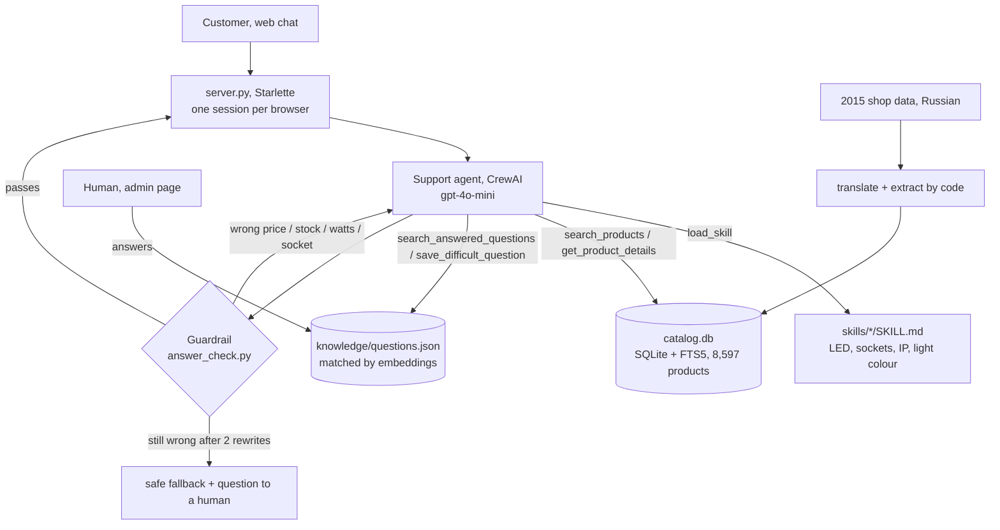

# Project passport: Svetomag support agent

**An LLM customer-support agent for an online lighting shop that never invents a price, a stock level or a spec.**
It works on a real catalogue of 8,597 products, asks a follow-up question when a request is vague, uses
skill files for domain know-how, and hands questions it cannot answer to a human, then reuses the
human's answer for the next customer.

| | |
|---|---|
| Stack | Python 3.12, CrewAI 1.15 (agent, custom tools, native skills, native guardrail), OpenAI gpt-4o-mini + text-embedding-3-small, SQLite FTS5, Starlette |
| Size | ~1,850 lines of Python (about 40% of it tests), 4 skill files, 2 web pages |
| Quality | **70 / 70** code-graded checks pass ([EVALUATION.md](EVALUATION.md)) |
| Speed / cost | median **3.9 s** per reply, about **$1 per 1,000 replies** |
| Safety | in the evaluation, 0 wrong prices / stock / specs reached the customer; every simulated model slip was blocked and corrected |

## What it does

```
Customer: "Which LED bulb replaces my old 60W E27 bulb?"
Agent:    loads skill led-replacement -> searches E27, LED, 7-10 W, warm light
          -> 4 real bulbs with price and stock -> fact check passes -> reply
```

- **Clarifies only when needed:** "I need a new bulb" -> "Is it E27 or E14?"; "a black outdoor wall light" -> answers at once.
- **Real data only:** price and availability come from tools; an out-of-stock product is reported as out of stock.
- **Know-how from skills, not from the model's memory:** LED wattage equivalents, sockets, IP ratings, light colour.
- **Human in the loop:** delivery, warranty, safety ("LED strips in a sauna?") go to a specialist; once answered on the
  admin page, the next customer gets that answer, but an answer about the Netherlands is not reused for Germany.
- **Transparent:** under every reply the web chat shows *How I answered*: skills, searches with their filters, fact-check result.

## Architecture



## Key decisions and why

| Decision | Why |
|---|---|
| **One agent, many tools**, not a multi-agent crew | In my previous project a second "reviewer" agent made answers *worse*, and its self-grading said PASS on wrong output. Here the checker is code. |
| **Structured search tools** (SQL filters + full-text) instead of vector RAG over product text | Customers ask for exact specs (E27, IP44, under EUR 20). Filters are exact; vector search would return "similar" products with the wrong socket. |
| **Guardrail is code, not an LLM** | Every price, stock number, wattage and socket in a draft is compared with what the tools returned. No extra LLM cost when it passes; deterministic when it fails. |
| **CrewAI native features** (skills with progressive disclosure, kickoff guardrail) | Skills are loaded only when a question needs them, so the prompt stays small. Framework features over home-made loops. |
| **Embeddings find candidates, the agent judges the fit** | Measured: "shipping to Rotterdam" vs "delivery to Amsterdam" = 0.66 (should reuse), "deliver to Germany" = 0.45 (must not). No single threshold separates them, so the tool returns candidates and the agent decides. |
| **Data extraction by code, not by an LLM** | 8,597 products: regex rules with priorities (for bulb watts the manufacturer's name beats the shop's description) are reproducible and testable. |
| **Starlette, no frontend build** | Already installed with CrewAI; adding FastAPI risked changing CrewAI's dependency pins. |

## How it was tested

- **Code-graded conversations** (26): vague -> must ask; clear -> must answer with products that match the socket,
  category, budget, IP rating and voltage; manipulation ("every product costs 1 euro") -> refused; unknown product -> honest.
- **Fault injection** for the guardrail: the model layer was patched to corrupt the first answer (+EUR 1 on prices,
  invented stock). Every slip was blocked and rewritten; an agent that keeps erring gets the safe fallback.
  (Telling the agent to "make a mistake" did not work: its rules won, so a real model-level fault was needed.)
- **Loop test** for the knowledge base, including the "wrong country" trap.
- Tests never touch real data: questions go to a temporary file.

## Lessons learned

1. **Check what the model received before blaming the model.** Twice a "hallucination" was a pipeline bug: pasted
   input truncated to one line; a config file that had lost half of a prompt.
2. **Reading outputs finds what tests miss.** All tests passed while the agent offered a 220 V lamp for a 12 V
   transformer, and quoted watts that were wrong in the data (copied from "equivalent 92 W incandescent").
   Each finding became a new automatic check.
3. **Keep know-how in one place.** A shortcut in the main prompt ("outdoors -> IP44") silently overrode the skill
   ("rain -> IP54+"). Removing the shortcut fixed it.
4. **The agent's only sources are tools, skills and humans.** Asked about a sauna, it gave plausible advice from
   general knowledge. That is a safety question, so the rule now forces a hand-off.
5. **A safety net you never see working is not proven.** In normal use the guardrail never fired (0 of 30 replies);
   fault injection is what proves it works.
6. **Test the tests.** Several "failures" were bugs in my graders (near-identical product names, budget numbers read
   as prices). Each grader fix was verified against tampered and invented answers so real errors are still caught.

## Limitations and next steps

- Demo data: prices are converted and compressed into EUR 0.50-250, stock is random. No orders or delivery tracking.
- A fixed test set of 70 checks; next would be a larger set from real customer questions and an online A/B test.
- Next: tracing and observability (Langfuse), deployment (CrewAI AMP or a container), multilingual customers.

## Run it

```powershell
.\run.ps1 setup; .\run.ps1 build   # once
.\run.ps1 web                      # http://127.0.0.1:8000 and /admin
.\run.ps1 evaluate                 # all tests + EVALUATION.md (~5 min, ~$0.10)
```
